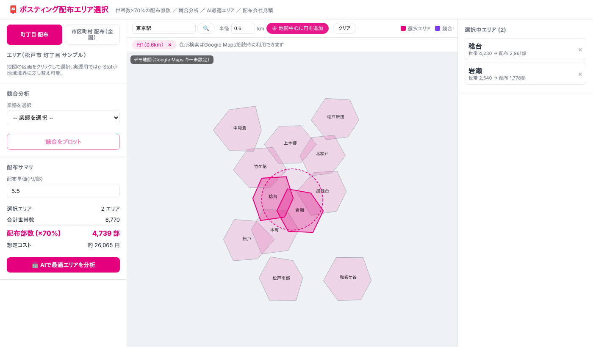

# ポスティング配布エリア選択システム

ラクスルの「地図から簡単注文」のように、**地図上でポスティング配布エリアを選び、配布部数を自動算出**するWebアプリのMVPです。カート/注文機能は持たず、**配布部数の算出とAIによる最適エリア分析に特化**しています。

- 🗾 **全国自治体対応** … 47都道府県・全1,916市区町村から選択。境界ポリゴンはオンデマンド取得＋キャッシュ
- 📍 **中心地のピン** … 住所・店舗名で検索するとピンを立てて地図を移動。「📍を地図の中心に移動」やドラッグでも動かせる
- 🧮 **部数で選ぶ（📍から約10,000部を追加）** … ピンに近い町丁目から順に、目標部数に最も近くなるまで自動選択。ピン周辺の市区町村は**県境をまたいで自動で読み込む**（例: 大和市の南林間 → 相模原市南区・町田市・座間市）
- 🎯 **円で範囲選択（Raksul仕様）** … 半径(km)を指定して「円を追加」→ ピンを中心に円内のエリアを一括選択。複数円OK（Google Mapsでは円の移動・半径変更も可）
- 📥 **配布部数表（エリア表）ダウンロード** … 市区町村名・町丁目名・世帯数・配布予定数（`=ROUNDDOWN(世帯数×カバー率,-1)`）と、選択エリア・円・ピンを描いた地図をExcelに出力（Googleスプレッドシートでもそのまま開ける）
- 🏘️ **町丁目配布（実境界）** … 全国どの市区町村でも、国勢調査の**実際の町丁目境界**を読み込んで町丁目ごとに選択。世帯数も町丁目単位の実数（令和2年国勢調査）
- 📮 **配布部数の自動算出** … 各エリアの世帯数（国勢調査／住民基本台帳）× **70%** を **10部単位で切り捨て**（配布部数表の `ROUNDDOWN(…,-1)` と同じ）
- 🔍 **競合分析** … 業態を選ぶと、その業態の競合が地図上にプロットされる
- 🤖 **AIによる最適エリア分析** … 世帯規模・競合密度・配布効率・コストをスコア化し、最適エリアをAIが提案・解説
- 🚚 **配布会社の原価・見積** … 選択エリアの各配布会社の原価/見積単価を集計（実データを徐々にプロットしていく土台）

| 町丁目 配布 | 市区町村 配布（全国） |
|---|---|
|  |  |

**円で範囲選択（Raksul仕様）**



## クイックスタート

```bash
npm run install:all          # ルート / server / client の依存をインストール
npm run dev                  # server:4000, client:5173（→ http://localhost:5173）

# 本番ビルド＋単一サーバー起動（http://localhost:4000）
npm run build && npm start
```

町丁目モードは、市区町村を選ぶと **e-Statから町丁目境界と世帯数を自動ダウンロード**します（初回のみ数秒、以降はキャッシュ）。e-Statへ接続できる環境で実行してください。

## データの実データ性と充填元

| データ | この状態での挙動 | 実データ源（実運用） |
|--------|------------------|----------------------|
| 全国市区町村マスタ（コード・名称・重心） | ✅ 実データ同梱（1,916件） | [localgovjp](https://github.com/code4fukui/localgovjp) |
| 市区町村の**世帯数** | ⚠️ 未接続時は `null`（部数は「—」表示）。**捏造値は入れていません** | **e-Stat API**（国勢調査／住基）|
| 市区町村の**境界ポリゴン** | ✅ 選択時にオンデマンド取得＋キャッシュ | **e-Stat 統計GIS 境界データ**（推奨）／[niiyz/JapanCityGeoJson](https://github.com/niiyz/JapanCityGeoJson)（キー不要フォールバック）|
| 町丁目の境界・世帯数 | ✅ 選択した市区町村ぶんを自動取得＋キャッシュ | e-Stat 境界データ（令和2年国勢調査 小地域）|
| 競合POI | ✅ サンプル生成／実POI取得 | Google Places API →（キー無ければ）OpenStreetMap Overpass |
| 配布会社 原価・見積 | ✅ サンプル同梱 | 各社と連携して蓄積（`server/data/pricing.sample.json`）|

> **世帯数について**: 「配布部数＝最新世帯数×70%」の**世帯数の正データはe-Stat**です。本リポジトリのビルド環境ではe-Statへ到達できないため、市区町村の世帯数は未接続時 `null`（誤った推計値は表示しない方針）。`ESTAT_APP_ID` を設定すると全国の部数が真値で算出されます。町丁目の世帯数は、e-Stat境界データに含まれる町丁目別の実世帯数（SETAI）を使います（APIキー不要）。

## 環境変数（`.env.example` を `.env` にコピー）

| 変数 | 用途 | 未設定時 |
|------|------|----------|
| `GOOGLE_MAPS_API_KEY` | 地図表示（Maps JavaScript API）・住所検索（Geocoding API）・配布部数表の地図（Maps Static API） | SVGデモ地図で描画 |
| `GOOGLE_STATIC_MAPS_KEY` | 配布部数表の地図用キー（任意。サーバー用にIP制限したキーを分けたい場合） | `GOOGLE_MAPS_API_KEY` を使用 |
| `GOOGLE_PLACES_API_KEY` | 競合POI検索（Places API New） | Overpass → サンプルにフォールバック |
| `ESTAT_APP_ID` / `ESTAT_STATS_DATA_ID` | 世帯数の実データ（e-Stat getStatsData） | 世帯数は取得せず `null` |
| `BOUNDARY_BASE` | 境界GeoJSONの取得元ベースURL | niiyz raw GitHub |
| `ANTHROPIC_API_KEY` / `CLAUDE_MODEL` | 最適エリアのAI解説（Claude API） | ルールベース解説 |
| `PRICING_DATA_PATH` | 配布会社 原価・見積データのパス | 同梱サンプル |

### e-Stat（世帯数）の接続手順と疎通確認
1. [e-Stat API](https://www.e-stat.go.jp/api/) でアプリケーションID(appId)を取得し `.env` の `ESTAT_APP_ID` に設定
2. **疎通確認スクリプトを実行**（statsDataId未設定なら候補を検索表示）:
   ```bash
   npm --prefix server run estat:check
   ```
3. 表示された候補から市区町村別世帯数の表を選び `ESTAT_STATS_DATA_ID` に設定して再実行。
   スクリプトが「接続 → メタ検出（世帯数分類の自動判定）→ 世帯数取得 → 全国マスタとの結合率」を検証し、
   松戸市などサンプル自治体の `世帯数 → 配布部数(×70%)` とPASS/FAILを表示します。
4. PASSしたら `server` を再起動すると、市区町村モードで**真値の配布部数**が表示されます。
5. 自動検出が合わない表では `ESTAT_HOUSEHOLD_CLASS` / `ESTAT_HOUSEHOLD_CODE` / `ESTAT_TIME_CODE` で明示できます。

> 実装は `server/services/estatClient.js`（getStatsList/getMetaInfo/getStatsData）。世帯数分類の検出・
> `@area`→市区町村コードの結合・全国/都道府県の除外・最新年フィルタを行います。パースは
> `npm --prefix server test`（`server/test/estatClient.test.mjs`, モック16項目）で検証済み。
### 配布部数表（エリア表）Excel
- 右パネル「📥 配布部数表」で店舗名・案件名を入れて「配布部数表ダウンロード（Excel）」を押すと、
  `【エリア表】_<店舗名>様_<案件名>_<部数>部エリア.xlsx` を出力します（シート名は「3万部エリア」など）。
- 列: 市区町村名 / 町丁目名（例: 南林間一丁目 → 南林間(1)）/ 世帯数 / 配布予定数（=ROUNDDOWN(世帯数×$F$1,-1)）/ 備考。F1 にカバー率、F2 に合計部数。
- G4 から右側に地図画像（選択エリア・町名ラベル・赤い円と半径・ピンと店名）を貼り付けます。
- 地図の背景には **Maps Static API** を使います。Google Cloud で「Maps Static API」を有効にし、APIキーの「APIの制限」にも追加してください。
  未設定でも、背景なし（エリア・円・ピンのみ）の地図で出力できます。
- Googleスプレッドシートで使う場合は、ダウンロードしたファイルをGoogleドライブにアップロードして開いてください（式も保持されます）。

### 町丁目データ（e-Stat 境界データ）
- 町丁目モードで市区町村を「＋読込」すると、サーバーが e-Stat から **令和2年国勢調査 小地域（町丁・字等別）** の境界データ（シェープファイル）をダウンロードし、
  町丁目ごとの **実境界ポリゴン・世帯数(SETAI)・人口(JINKO)** に変換して `server/data/towns/<市区町村コード>.json` にキャッシュします。
- 事前取得・動作確認: `npm --prefix server run towns:fetch -- 12207`（複数コード可）
- e-Statへ接続できない環境では、[e-Stat 境界データ](https://www.e-stat.go.jp/gis/statmap-search?type=2)から
  「国勢調査 → 2020年 → 小地域（町丁・字等別）→ 世界測地系緯度経度・Shapefile」を市区町村単位でダウンロードし、
  `server/data/towns/raw/<市区町村コード>.zip` に置けば読み込まれます。
- 分割された町丁目は1区画に統合（世帯数は重複計上しない）、水面調査区は除外します。

## アーキテクチャ

```
server/                     Node.js + Express API
├── routes/
│   ├── towns.js            /api/towns         町丁目（実境界・世帯数・部数）
│   ├── municipalities.js   /api/municipalities 全国自治体一覧・都道府県・境界オンデマンド・周辺(nearby)
│   ├── competitors.js      /api/competitors   業態マスタ・競合検索
│   ├── analyze.js          /api/analyze       最適エリア分析（スコア+見積+AI解説）
│   ├── pricing.js          /api/pricing       配布会社一覧・見積
│   ├── staticmap.js        /api/staticmap     配布部数表の地図背景（Static Maps 中継）
│   └── export.js           /api/export        配布部数表（エリア表）Excel
├── services/
│   ├── estat.js            市区町村の世帯数（e-Stat API）＋ 配布率70%
│   ├── towns.js            町丁目: e-Stat境界データ取得→変換→キャッシュ
│   ├── boundaries.js       境界のオンデマンド取得・簡略化・キャッシュ
│   ├── areas.js            コード+粒度 → エリア解決（境界結合）
│   ├── places.js           競合検索（Google → Overpass → サンプル）
│   ├── scoring.js          4軸スコアリング（世帯数nullは対象外）
│   ├── pricing.js          配布会社 原価・見積
│   ├── claude.js           Claude API 解説（or ルールベース）
│   └── geo.js              内包判定・面積・重心・距離・簡略化(DP)
└── data/
    ├── municipalities.json      全国市区町村マスタ（実データ）
    ├── towns/                   町丁目データのキャッシュ（実行時生成）
    ├── business-types.json      業態マスタ
    ├── pricing.sample.json      配布会社 原価・見積サンプル
    └── boundaries/              取得済み境界のキャッシュ

client/                     React + Vite
└── src/
    ├── App.jsx                  2モード（町丁目 / 市区町村）状態管理
    ├── components/
    │   ├── GoogleMapView.jsx    Google Maps（ポリゴン+候補点+競合）
    │   └── SvgMapView.jsx       キー未設定時のSVGフォールバック地図
    └── lib/{api,googleMaps}.js
```

## スコアリングの考え方（`server/services/scoring.js`）

| 軸 | 指標 | 重み |
|----|------|------|
| 到達 (reach) | 世帯数（配布到達数） | 35% |
| 競合機会 (opportunity) | 世帯数 ÷ (競合数+1) | 30% |
| 配布効率 (efficiency) | 世帯密度 | 20% |
| コスト効率 (cost) | 到達世帯 ÷ 配布コスト（配布会社の最安見積単価を反映） | 15% |

各軸を0–100に正規化し重み付け。世帯数が未取得のエリアは対象外（`skipped`）として明示します。`ANTHROPIC_API_KEY` を設定するとClaudeが最適エリアの理由・優先度・予算配分を日本語で解説します。

## 今後の拡張

- **配布会社の原価・見積を徐々にプロット** … `pricing.sample.json` を各社実データに差し替え／エリア別単価を蓄積（データモデルは実装済み）
- 競合の口コミ評価を加味したスコアリング、商圏（到達圏）解析
```
